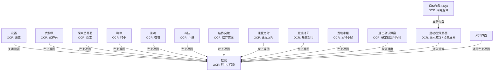

# UI-MAP generated view

> Generated by `oasd ui-map render`; do not hand-edit.

Goal: `courtyard`

## Interfaces

| ID | title | type | OCR markers | actions |
|---|---|---|---|---|
| `boss` | 逢魔之时 | screen | 逢魔之时 | default_back |
| `bounty` | 悬赏封印 | screen | 悬赏封印 | default_back |
| `breakthrough` | 结界突破 | screen | 结界突破 | default_back |
| `courtyard` | 庭院 | screen | 町中 / 召唤 |  |
| `duel` | 斗技 | screen | 斗技 | default_back |
| `exit_confirm` | 退出确认弹窗 | popup | 确定退出阴阳师 | cancel |
| `exploration` | 探索总界面 | screen | 探索 | default_back |
| `loading` | 启动加载 Logo | loading | 网易游戏 | wait_ready |
| `pet_house` | 宠物小屋 | screen | 宠物小屋 | default_back |
| `settings` | 设置 | screen | 设置 | close |
| `shikigami` | 式神录 | screen | 式神录 | default_back |
| `soul` | 御魂 | screen | 御魂 | default_back |
| `startup` | 启动/登录界面 | startup | 进入游戏 / 点击屏幕 | click_screen, enter |
| `town` | 町中 | screen | 町中 | default_back |
| `unknown` | 未知界面 | unknown |  | default_back |

## Transitions

| from | to | action | label | priority |
|---|---|---|---|---|
| `settings` | `courtyard` | `close` | 关闭设置 | 10 |
| `shikigami` | `courtyard` | `default_back` | 左上返回 | 10 |
| `exploration` | `courtyard` | `default_back` | 左上返回 | 10 |
| `town` | `courtyard` | `default_back` | 左上返回 | 10 |
| `soul` | `courtyard` | `default_back` | 左上返回 | 10 |
| `duel` | `courtyard` | `default_back` | 左上返回 | 10 |
| `breakthrough` | `courtyard` | `default_back` | 左上返回 | 10 |
| `boss` | `courtyard` | `default_back` | 左上返回 | 10 |
| `bounty` | `courtyard` | `default_back` | 左上返回 | 10 |
| `pet_house` | `courtyard` | `default_back` | 左上返回 | 10 |
| `exit_confirm` | `courtyard` | `cancel` | 取消退出 | 20 |
| `startup` | `courtyard` | `enter` | 进入游戏 | 20 |
| `loading` | `startup` | `wait_ready` | 等待加载 | 10 |
| `unknown` | `courtyard` | `default_back` | 通用左上返回 | 100 |
